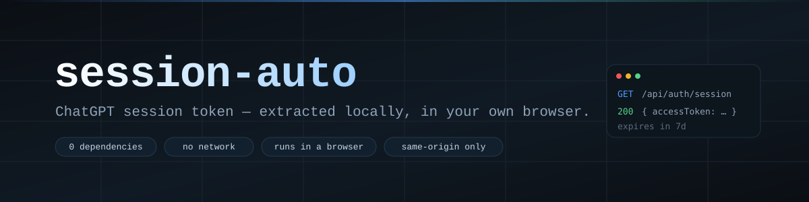

<div align="center">



**Get your ChatGPT session token — locally, in your own browser.**

[English](README.md) · [简体中文](README.zh-CN.md)


</div>

---

## The problem

`https://chatgpt.com/api/auth/session` is a first-party endpoint. Open it in a tab while
logged in and it returns a small JSON object holding your identity token:

```json
{ "user": { … }, "expires": "…", "accessToken": "eyJhbGciOi…" }
```

That is the whole trick. There is no API key to generate and nothing to install — but the
value is easy to lose: it gets truncated in the UI, it is ~1–2 KB of base64url, and a single
copy/paste into a chat window leaks a credential that is equivalent to your password.

This repository documents the safe, minimal path: **one same-origin request, made from the
page that already has your cookies, with nothing sent anywhere else.**

## How it works

```text
  your browser (already logged in to chatgpt.com)
        │
        │  fetch('/api/auth/session')   ← relative URL, cookies attached by the browser
        ▼
  chatgpt.com  ──────────────────────►  { accessToken: "eyJ…" }
        │
        ▼
  DevTools console / bookmarklet  ──►  copy the token, or read its `exp`
```

The token is a JWT. Its payload carries an `exp` claim, so you can read when it dies without
any server-side call:

```js
const { accessToken } = await (await fetch('/api/auth/session')).json();
JSON.parse(atob(accessToken.split('.')[1])).exp;
```

## Quick start

1. Log in at <https://chatgpt.com>, then press <kbd>F12</kbd> → **Console**.
2. Paste one line:

   ```js
   (await (await fetch('/api/auth/session')).json()).accessToken
   ```

3. Right-click the printed string → **Copy string contents**.

That's it. No extension, no userscript, no third-party site ever sees the value.

> **Prefer a bookmarklet?** `javascript:` links are blocked on pages whose CSP sets
> `script-src 'none'`. When the bookmark does nothing, the console path above still works —
> DevTools is not subject to the page's CSP.

## Safety

| Rule | Why |
|---|---|
| Never paste the token into a chat, an issue, or a screenshot | It is a bearer credential — whoever holds it *is* you until it expires |
| Treat it as a password, because it is one | No second factor is asked for on API calls that carry it |
| Do not store it in a synced folder or a notes app | Sync + plaintext = a leak with a latency of minutes |
| If it leaked: **log out of all devices**, then change the password | Rotating the password invalidates outstanding sessions |

A masked preview (`eyJhbGciOi…4f2a1b`) is safe to share. The token itself is not.

## Limits

- **Cross-origin reads are impossible by design.** A page served from `file://`, `localhost`,
  or GitHub Pages cannot read `chatgpt.com` cookies or call that endpoint on your behalf.
  Anything claiming otherwise is either a proxy that sees your token, or wrong.
- The token expires; there is no refresh flow documented here.
- Nothing in this repository talks to a network service. That is the point.

## Status

This repo currently holds the **method and the exact commands**, not a packaged UI. Planned:

- [ ] A single-file HTML page (`index.html`, `file://`-friendly, CSP `default-src 'none'`)
      that takes a pasted JSON blob or a released file and prints `sessionToken.txt`
- [ ] A `verify.mjs` test that asserts the parsing rules against fixtures
- [ ] A sanitized screenshot for this README

## License

Not declared yet. Assume all rights reserved until a `LICENSE` file appears.