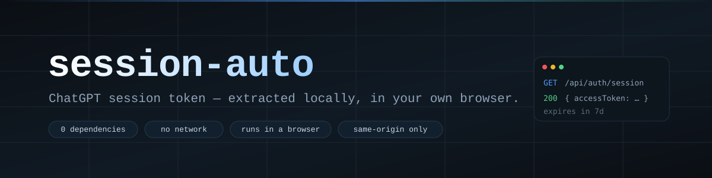

<div align="center">



**在自己的浏览器里，本地取出 ChatGPT 的 sessionToken。**

[English](README.md) · [简体中文](README.zh-CN.md)


</div>

---

## 要解决的问题

`https://chatgpt.com/api/auth/session` 是 ChatGPT 自己的接口。登录状态下用浏览器打开它，会返回一小段 JSON，里面就是你的身份令牌：

```json
{ "user": { … }, "expires": "…", "accessToken": "eyJhbGciOi…" }
```

道理就这么点：不用申请 API Key，也不用装任何东西。麻烦在于**取值**——它在界面上会被截断，本身是 1–2 KB 的 base64url 长串，随手复制到聊天窗口就等于把密码交出去了。

这个仓库只记录最省事的那条路：**在你已经登录的那个页面里发一次同源请求，令牌不经过任何第三方。**

## 原理

```text
  你的浏览器（已登录 chatgpt.com）
        │
        │  fetch('/api/auth/session')   ← 相对路径，Cookie 由浏览器自动附带
        ▼
  chatgpt.com  ──────────────────────►  { accessToken: "eyJ…" }
        │
        ▼
  控制台 / 书签小工具  ──────────────►  复制令牌，或读出它的 `exp`
```

令牌是 JWT，载荷里有 `exp`，不联网也能知道它什么时候失效：

```js
const { accessToken } = await (await fetch('/api/auth/session')).json();
JSON.parse(atob(accessToken.split('.')[1])).exp;
```

## 三步拿到

1. 登录 <https://chatgpt.com>，按 <kbd>F12</kbd> 打开 **Console**。
2. 粘一行：

   ```js
   (await (await fetch('/api/auth/session')).json()).accessToken
   ```

3. 右键打印出的那串字符 → **Copy string contents**。

完。不装扩展、不装脚本，也不经过任何第三方站点。

> **想用书签？** 页面 CSP 若设了 `script-src 'none'`，`javascript:` 书签会被浏览器拦掉。
> 点了没反应就回到上面的控制台方式——开发者工具不受页面 CSP 约束。

## 安全边界

| 规则 | 原因 |
|---|---|
| 别把令牌贴进聊天、issue、截图 | 它是 bearer 凭证，谁拿到，在过期前谁就是你 |
| 把它当密码对待，因为它就是密码 | 携带它的接口不会再问你要二次验证 |
| 别存进同步盘、备忘录 | 明文 + 同步 = 一条几分钟内扩散的泄露 |
| 一旦泄露：**登出所有设备**，再改密码 | 改密码会让已发出的会话失效 |

打码后的预览（`eyJhbGciOi…4f2a1b`）可以外发，完整令牌不行。

## 做不到的事

- **跨站读取在设计上就不可能。** 跑在 `file://`、`localhost` 或 GitHub Pages 上的页面，读不到 `chatgpt.com` 的 Cookie，也没法替你调那个接口。声称能做到的，要么是个看得见你令牌的代理，要么就是错的。
- 令牌会过期，这里不涉及刷新流程。
- 本仓库里没有任何代码会访问网络服务——这正是重点。

## 当前状态

仓库目前只放**做法和确切命令**，还没有打包好的界面。计划中：

- [ ] 单文件 `index.html`（`file://` 可直接打开，CSP 设为 `default-src 'none'`），接受粘贴的 JSON 或文件，输出 `sessionToken.txt`
- [ ] `verify.mjs`：用固定样本校验取值规则
- [ ] 一张脱敏后的截图，放进本页

## 许可

暂未声明。在出现 `LICENSE` 文件之前，默认保留所有权利。